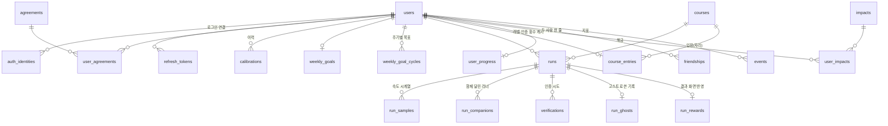

# SCRUN 데이터 모델 (DB 테이블) v1

서버가 무엇을 어떻게 저장하는지. 계획 [0015](../plans/0015-data-model.md), 백로그 BL-39. API가 주고받는 모양은 [README.md](README.md)·`backend/app/schemas/`, 이 문서는 그 뒤의 저장 구조다. 코드는 `backend/app/db/models.py`, DB 변경 기록은 `backend/migrations/`(계획 0016에서 v1 그대로 만듦). 테이블을 바꾸면 이 문서도 같이 고친다.

## 원칙
- **DB**: PostgreSQL(ADR-0008 제안)
- **ID**: 시간순 정렬되는 문자열(ULID). API에선 앞에 종류를 붙여 보여 줌(`usr_`, `run_`, `vrf_` …). 운영 데이터(코스·임팩트·약관)는 읽기 쉬운 고정 ID(`crs_lake_loop`)
- **시각**: 전부 `timestamptz`(UTC). 사용자 시간대는 `users.timezone`, 주간 목표 주기는 서버가 그 시간대로 계산
- **계정 삭제**: 사용자에 딸린 모든 행은 `users` 삭제 때 같이 지워진다(`ON DELETE CASCADE`). 다른 사람 기록 안에 남는 내 흔적(함께 달린 러너)도 지운다. 백업에 남는 기간은 개인정보처리방침에 적음(BL-40)
- **판정은 서버**: 공식 기록 값·레벨·인증 횟수·주간 목표 집계는 서버가 정해 저장. 캐시(`user_progress`)는 기록에서 언제든 다시 계산할 수 있게
- **저장 안 하는 것**: 계기판 사진(OCR 직후 폐기), 실시간 위치(실시간 서버 메모리), 맵 인스턴스(실시간 서버, BL-25 뒤), 봇 수·페이스·레벨 임계값(서버 설정 파일)
- **미정은 칸만**: OCR 위치(서버든 앱이든 `verifications`에 읽은 값이 들어감), 오프라인 달리기(`runs.client_run_id`로 나중 업로드 가능), 데이터 보관 기간(Q-27)

## 관계 그림

## 테이블
형식: `text`, `int`, `smallint`, `bool`, `real`, `real[]`, `jsonb`, `date`, `timestamptz`. 모든 테이블에 `created_at timestamptz`(생략). **굵게** = 기본 키, → = 외래 키(괄호는 지울 때 동작).

### 계정
**users** — 사용자 1명 = 1줄. 가입(`POST /v1/auth/signup`) 때 생김. 카카오 로그인만 하고 가입 전인 사람은 줄이 없음(가입용 토큰에 카카오 ID가 들어 있음)
| 칸 | 형식 | 설명 |
|---|---|---|
| **id** | text | |
| nickname | text | 유일(대소문자 무시). 2에서 12자, 금칙어 검사 |
| height_cm | smallint | 아바타 크기 |
| weight_kg | smallint | 속도 추정엔 안 씀(용도는 개인정보처리방침에) |
| timezone | text | `Asia/Seoul` 등 |
| friend_code | text | 유일. `SCR-XXXX` |
| feed_share_default | bool | 새 기록 공유 기본값(PRD: 켜짐) |
| updated_at | timestamptz | |

**auth_identities** — 로그인 제공자별 연결. 한 사용자에 카카오·Apple을 함께 붙일 수 있게 분리(PRD Q-39)
| 칸 | 형식 | 설명 |
|---|---|---|
| **id** | text | |
| user_id | → users (CASCADE) | |
| provider | text | `KAKAO`·`APPLE`·`GOOGLE` |
| provider_user_id | text | 카카오 회원번호 등. (provider, provider_user_id) 유일 |

**refresh_tokens** — access 토큰은 저장 안 함(짧은 수명, 서명으로 확인). 로그인 한 번 = family 하나, 재발급하면 같은 family에 새 줄(규칙은 [README "로그인"](README.md), 코드 `backend/app/core/sessions.py`)
| 칸 | 형식 | 설명 |
|---|---|---|
| **id** | text | |
| user_id | → users (CASCADE) | |
| family_id | text (색인) | 처음 로그인 때 만든 줄의 id. 탈취 의심·로그아웃 때 이 단위로 폐기 |
| device_id | text | 앱이 보낸 기기 ID(없을 수 있음). 같은 기기 재로그인 때 예전 것 폐기 |
| token_hash | text | 원문은 저장 안 함 |
| expires_at | timestamptz | 만료 줄은 로그인 때(그 사용자)와 하루 한 번 정리(`scripts/purge_refresh_tokens.py`)에서 삭제 |
| revoked_at | timestamptz | 폐기 시각 |
| revoked_reason | text | `ROTATED`(재발급) · `LOGOUT` · `REUSED`(탈취 의심) · `REPLACED`(같은 기기 재로그인) · `LIMIT`(로그인 5개 초과). revoked_at과 같이 있거나 같이 없음 |
| replaced_by_id | text | ROTATED일 때 대신 나간 줄. 30초 유예 판단(그 줄을 아직 안 썼는지). 유예 재시도면 새 줄로 바뀜 |

**agreements** — 약관 목록(운영 데이터) / **user_agreements** — 동의 기록
| 테이블 | 칸 |
|---|---|
| agreements | **id**, title, required(bool), version, url |
| user_agreements | **user_id**(→ users CASCADE), **agreement_id**(→ agreements), **version**, agreed_at |

### 보정·목표
**calibrations** — 보정값 이력. 가장 최근 것이 현재 보정. 계산은 폰, 서버는 보관만. **OCR 값을 넣을 칸이 없음**(독립성 원칙)
| 칸 | 형식 | 설명 |
|---|---|---|
| **id** | text | |
| user_id | → users (CASCADE) | |
| points | jsonb | 보정 구간들(속도·걷기/달리기·초) |
| model | jsonb | 폰 `SpeedEstimator`가 만든 계수. 서버는 해석 안 함 |
| device | text | 폰 기종. 바뀌면 재보정 안내 |

**weekly_goals** — 지금 목표 설정(1인 1줄)
| 칸 | 형식 | 설명 |
|---|---|---|
| **user_id** | → users (CASCADE) | |
| target_count | smallint | 1에서 7 |
| anchor_date | date | 처음 설정한 날. 주기 = 이날부터 7일 단위 |
| next_target_count | smallint | 변경 예약값, 다음 주기부터 |

**weekly_goal_cycles** — 주기별 목표 기록(이력 8주기를 그때 목표로 보여 주려고). 주기가 시작될 때 만들어짐. 달성 횟수는 저장 안 하고 `runs`에서 셈
| 칸 | 형식 | 설명 |
|---|---|---|
| **user_id** | → users (CASCADE) | |
| **cycle_start** | date | |
| target_count | smallint | 그 주기의 목표 |

### 코스
**courses** — 운영 데이터
| 칸 | 형식 | 설명 |
|---|---|---|
| **id** | text | `crs_lake_loop` |
| name, description, mood | text | |
| thumbnail_url | text, null | 없으면 null(앱 기본 그림) |
| type | text | `LOOP_3D`·`VIDEO`(실사 영상은 최하위, 자리만) |
| length_m | int | |
| max_runners_per_map | smallint | 20 |
| active | bool | 목록에 보일지 |

코스 데이터는 마이그레이션으로 넣는다(`seed_courses`, 계획 0021): 기존 섬 맵(Island01) 코스 4개 `crs_lake_loop`·`crs_coast_run`·`crs_forest_run`·`crs_island_tour`, 길이는 Unity `RoadNetwork.BuildRoute`와 같은 계산으로 잰 한 바퀴 m(6671·8776·9695·10884). 임시 맵이라 새 맵(BL-43 3km 루프)이 나오면 새 마이그레이션으로 바꾼다

**course_entries** — 맵 입장 = 자리 잡기. 사람당 한 줄(다른 코스에 들어가면 옮겨짐). 입장 API가 코스 줄을 잠그고(`SELECT … FOR UPDATE`) 인원을 센 뒤 여기에 써서, 동시에 들어와도 최대 인원을 넘지 않는다(계획 0021). 실시간 서버(BL-25) 뒤에는 연결 수로 세므로 다시 본다
| 칸 | 형식 | 설명 |
|---|---|---|
| **user_id** | → users | 사람당 한 줄 |
| course_id | → courses | |
| entered_at | timestamptz | 마지막 입장 시각. 최근 10분(임시) 안이면 인원에 셈 |

### 러닝·인증
**runs** — 러닝 1번 = 1줄. **② 공식 값과 미인증 사유를 따로 저장**
| 칸 | 형식 | 설명 |
|---|---|---|
| **id** | text | |
| user_id | → users (CASCADE) | |
| client_run_id | text | 앱이 만든 ID. (user_id, client_run_id) 유일 → 같은 요청 두 번이어도 한 줄 |
| course_id | → courses | |
| map_instance_id | text | 실시간 서버의 맵 ID(참고용, 외래 키 아님) |
| goal_type, goal_value | text, int | `DISTANCE`(m)·`TIME`(초)·`NONE` |
| status | text | `ACTIVE`(달리는 중) → `PENDING`(끝, 인증 대기) → `VERIFIED`·`UNVERIFIED`. 복구 안 하고 버리면 `DISCARDED` |
| started_at, ended_at | timestamptz | |
| sensor_distance_m, sensor_duration_s | int | 센서 값(항상) |
| console_distance_m, console_duration_s | int | 계기판 값(인증 완료일 때만) |
| official_source | text | `CONSOLE`·`SENSOR` |
| official_distance_m, official_duration_s | int | **공식 값**: 인증 완료면 계기판, 미인증이면 센서. 피드·경험치·주간 목표가 이 값을 씀 |
| unverified_reason | text | `MISMATCH`·`UNSUPPORTED_CONSOLE`·`SKIPPED`·`TIMEOUT`·`RETAKE_GIVEN_UP` |
| verification_deadline | timestamptz | 운동 직후에만 인증 가능(이후 `VERIFICATION_CLOSED`) |
| shared | bool | 친구 피드 공유(기본값은 `users.feed_share_default`) |
| updated_at | timestamptz | 세션 복구 24시간은 `status = ACTIVE`와 `updated_at`으로 판단 |

**run_samples** — 속도 시계열. 나눠 올린 묶음마다 1줄. 고스트 재생·인증 대조 근거. 30분 달리기 0.5초 간격이면 약 3,600개(작음). 커지면 Object Storage로(ADR-0008)
| 칸 | 형식 | 설명 |
|---|---|---|
| **run_id** | → runs (CASCADE) | |
| **offset_s** | real | 러닝 시작부터 이 묶음 시작까지(초) |
| interval_s | real | 칸 간격 |
| speeds_kmh | real[] | |

**run_companions** — 함께 달린 러너(기록 상세 화면)
| 칸 | 형식 | 설명 |
|---|---|---|
| **run_id** | → runs (CASCADE) | |
| **seq** | smallint | |
| kind | text | `RUNNER`·`FRIEND`·`BOT` |
| companion_user_id | → users (CASCADE) | 봇이면 비움. 그 사람이 탈퇴하면 이 줄도 지움 |
| bot_label | text | 봇 이름(`페이스 9`) |

**verifications** — 인증 시도마다 1줄(재촬영 포함). 사진은 저장 안 함
| 칸 | 형식 | 설명 |
|---|---|---|
| **id** | text | |
| run_id | → runs (CASCADE) | |
| method | text | `PHOTO`(서버 OCR)·`READING`(앱이 읽은 값)·`SKIP` — OCR 위치 미정이라 둘 다 |
| read_distance_m, read_duration_s | int | 계기판에서 읽은 값(OCR 실패면 비움) |
| status | text | `VERIFIED`·`UNVERIFIED`·`RETAKE_REQUIRED` |
| reason | text | 미인증 사유 |
| comparison | jsonb | 대조 표(항목·계기판·센서·차이·통과) |

**run_ghosts** — **③ 고스트 선택은 기록과 분리**: "이 러닝에서 어떤 기록을 고스트로 썼나"
| 칸 | 형식 | 설명 |
|---|---|---|
| **run_id** | → runs (CASCADE) | 고스트와 함께 달린 러닝 |
| ghost_run_id | → runs (SET NULL) | 고스트로 쓴 내 과거 기록 |

**run_rewards** — 이번 운동의 반영 결과(결과 화면 E-11을 다시 열 때 그대로 보여 주려고 저장)
| 칸 | 형식 | 설명 |
|---|---|---|
| **run_id** | → runs (CASCADE) | |
| xp_before_m, xp_after_m | int | |
| level_before, level_after, outfit_stage_after | smallint | |
| impacts_unlocked | text[] | 이번에 해금된 임팩트 ID |
| weekly_counted | bool | 주간 목표 1회로 인정됐는지 |

### 보상
**user_progress** — 캐시(1인 1줄). 인증 완료 기록에서 다시 계산 가능
| 칸 | 형식 | 설명 |
|---|---|---|
| **user_id** | → users (CASCADE) | |
| xp_m | int | 인증 완료 공식 거리 합(줄지 않음) |
| level, outfit_stage | smallint | 임계값(3·10·25·50·100 km)은 서버 설정 |
| verified_count | int | 인증 완료 횟수(인증 마크) |
| selected_impact_id | → impacts | |

**impacts**(운영 데이터: **id**, name, unlock_at_count, sort) / **user_impacts**(**user_id** → users CASCADE, **impact_id** → impacts, unlocked_at)

### 친구·지표
**friendships** — 두 사람 한 줄(작은 ID를 앞에). 50명 제한은 서버 코드에서
| 칸 | 형식 | 설명 |
|---|---|---|
| **user_a_id** | → users (CASCADE) | user_a_id < user_b_id |
| **user_b_id** | → users (CASCADE) | |

피드는 따로 저장하지 않음: 친구들의 `runs`(`shared`, 상태 `VERIFIED`·`UNVERIFIED`)를 시각순으로 조회.

**events** — PRD 2.4 지표(목표 완주율·재방문율·인증 성공률·지루함)
| 칸 | 형식 | 설명 |
|---|---|---|
| **id** | text | |
| user_id | → users (CASCADE) | |
| name | text | `APP_OPEN`·`RUN_GOAL_REACHED` 등(목록은 상준과 확정) |
| occurred_at | timestamptz | |
| props | jsonb | |

## 계산으로 얻는 값 (저장 안 함)
| 값 | 계산 |
|---|---|
| 주간 목표 달성 횟수 | 이번 주기(사용자 시간대) 안 `runs`: `status = VERIFIED` 그리고 `official_duration_s ≥ 300` |
| 지금 달리는 친구 | 친구의 `runs.status = ACTIVE`(실시간 서버가 생기면 그쪽 상태로) |
| 코스별 지금 러너 수 | 실시간 서버 연결 수(ADR-0010). 그 전에는 최근 10분 안에 입장(`course_entries`)했거나 달리는 중(`runs.status = ACTIVE`, `updated_at` 최근 10분)인 사람 수. 세는 곳은 `app/core/occupancy.py` 한 곳 |
| 피드 | 위 친구 피드 조회 |
| 평균 페이스 | 공식 시간 ÷ 공식 거리 |

## API ↔ 테이블
R = 읽기, W = 쓰기. (노션 API 명세 42개)
| API | 테이블 |
|---|---|
| POST /v1/auth/kakao | R auth_identities · W refresh_tokens |
| GET /v1/agreements | R agreements |
| POST /v1/auth/signup | W users, auth_identities, user_agreements, refresh_tokens, user_progress |
| POST /v1/auth/refresh | R·W refresh_tokens |
| POST /v1/auth/logout | W refresh_tokens |
| GET /v1/users/nickname/check | R users |
| GET /v1/users/me | R users |
| PATCH /v1/users/me | W users |
| DELETE /v1/users/me | W users(삭제 → 전부 CASCADE) |
| GET·PATCH /v1/users/me/settings | R·W users.feed_share_default |
| GET·PUT /v1/users/me/calibration | R·W calibrations |
| GET /v1/users/me/weekly-goal | R weekly_goals, weekly_goal_cycles, runs |
| PUT /v1/users/me/weekly-goal | W weekly_goals, weekly_goal_cycles |
| GET /v1/home | R weekly_goals, weekly_goal_cycles, user_progress, impacts, user_impacts, friendships, runs, courses |
| GET /v1/courses, /v1/courses/{courseId} | R courses, course_entries, runs (+ 실시간 러너 수) |
| POST /v1/courses/{courseId}/entries | R courses(잠금), calibrations, runs · W course_entries (+ 실시간 서버) |
| POST /v1/runs | W runs, run_ghosts |
| PUT /v1/runs/{runId}/samples | W run_samples |
| POST /v1/runs/{runId}/finish | W runs, run_companions |
| GET /v1/runs/active | R runs |
| POST /v1/runs/{runId}/discard | W runs |
| GET /v1/runs | R runs, courses |
| GET /v1/runs/{runId} | R runs, run_samples, run_companions, run_ghosts |
| PATCH /v1/runs/{runId} | W runs.shared |
| GET /v1/runs/{runId}/ghost | R runs, run_samples |
| POST /v1/runs/{runId}/verification/photo·reading·skip | W verifications, runs, run_rewards, user_progress, user_impacts · R weekly_goals |
| GET /v1/runs/{runId}/rewards | R run_rewards, impacts |
| GET /v1/users/me/progress | R user_progress, impacts, user_impacts |
| PUT /v1/users/me/impact | W user_progress · R user_impacts |
| POST /v1/friends | R users(friend_code) · W friendships |
| GET /v1/friends | R friendships, users, user_progress, runs |
| GET /v1/friends/running | R friendships, runs, courses |
| GET /v1/friends/{userId} | R friendships, users, user_progress, runs |
| DELETE /v1/friends/{userId} | W friendships |
| POST /v1/friends/{userId}/run-together | R friendships, runs, courses (+ 실시간 서버) |
| GET /v1/feed | R friendships, runs, users |
| POST /v1/events | W events |

## PRD 09장 대응
| PRD 데이터 | 테이블 |
|---|---|
| 사용자(식별·프로필·키·몸무게) | users, auth_identities |
| 아바타(레벨·인증 마크 수) | user_progress |
| 속도 보정(값·조건·이력) | calibrations |
| 러닝 세션(시각·코스·목표·함께한 러너) | runs, run_companions |
| 측정 기록(속도 시계열·거리) | run_samples, runs.sensor_* |
| 운동 결과(공식 값) | runs.official_* |
| 인증(OCR 결과·대조·상태·미인증 사유) | verifications, runs.unverified_reason |
| 고스트러너(참조 기록·재생 시계열) | run_ghosts, run_samples |
| 페이스 봇(설정·배치) | 서버 설정 파일(저장 안 함) |
| 친구(관계·피드·러닝 상태) | friendships, runs |
| 주간 목표(횟수·주기 시작일·주기별 현황) | weekly_goals, weekly_goal_cycles(+ runs로 계산) |
| 인증 마크(누적 횟수·해금 임팩트) | user_progress.verified_count, user_impacts |
