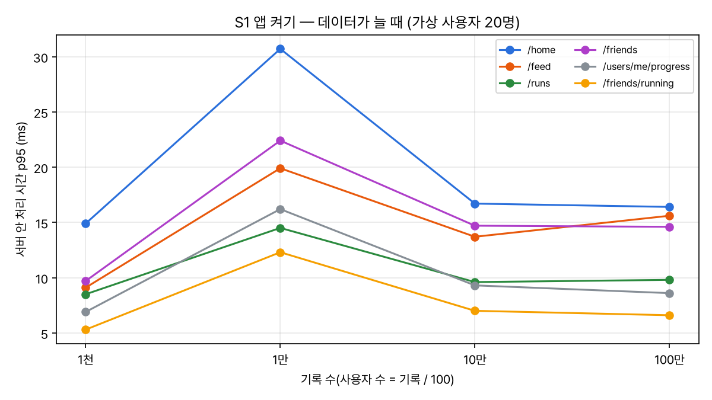
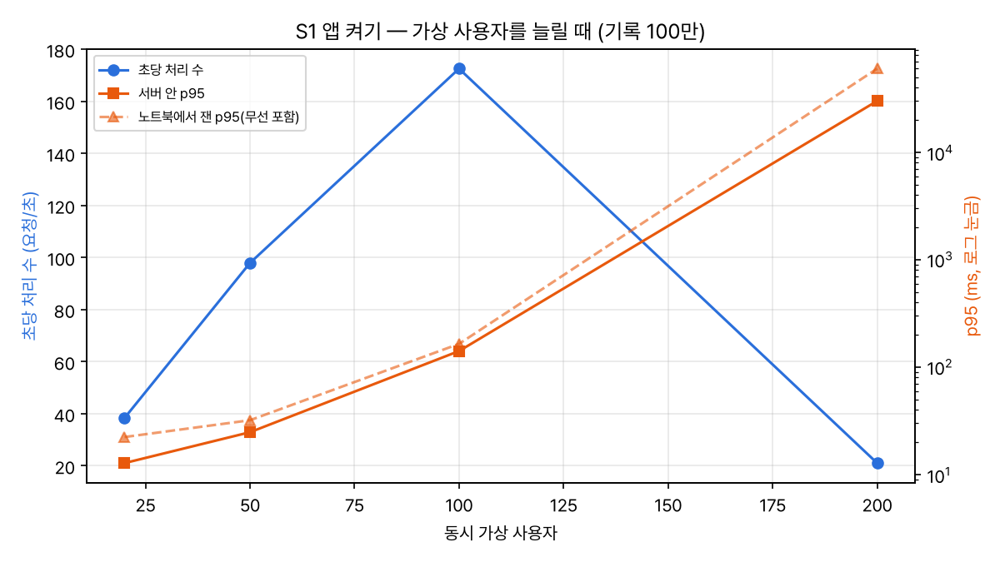
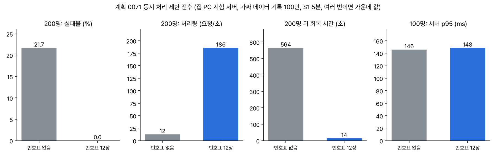

# 서버 성능 기준선 (계획 0070)

서버 개선(OCR 큐, 쿼리·인덱스, 실시간 확장) 전후를 같은 시험으로 비교하기 위한 첫 측정. 결정은 [ADR-0014](../adr/0014-load-test-k6.md)(k6), 계획 [0070](../plans/0070-load-test-observability.md).

**이 숫자를 쓸 때 주의**: 시험 서버는 집 PC(x86)라 운영(오라클 ARM 2코어)과 절대 수치가 다르다. 병목 순위·포화 모양·개선 전후 비교에 쓴다. 데이터는 가짜(`seed_load.py`, 실제 사용자 수 예측 아님). 보고서·발표에 쓸 땐 "집 PC 시험 서버, 가짜 데이터"를 같이 적는다.

## 환경 (2026-11-25)
| | |
|---|---|
| 시험 서버 | 집 PC: Ryzen 5 5600(6코어·12스레드), 15.9 GB, Windows + Docker Desktop(WSL2 8.3 GB), 무선. `backend/perf/docker-compose.perf.yml`: 운영과 같은 이미지·단일 uvicorn(11/26 계획 0073부터 운영과 같은 api 2개·realtime·ocr + Caddy), `KAKAO_MODE=fake`, api·db가 논리 CPU 2개(`cpuset 0,1`) 공유, api 3 GB·db 4 GB 한도, 연결 풀 기본값(5 + 넘침 10, 대기 30초) |
| 부하 | 노트북 k6 v2.4.0(Core Ultra 5 225H), 같은 공유기 무선. 노트북 → PC ping 1–18 ms |
| 서버 커밋 | S1·S2·S4: `feat/seed-load` ff7d050·5db1df9(develop c5180c6 + 시험 스크립트). S3 고친 뒤: `fix/pool-wait-lazy` 1328a0e |
| 데이터 | `seed_load.py --seed 70`: 사용자 = 기록/100, 친구 0–50, 기록 상태 인증 55%·미인증 40%·버림 5%. 100만 단계는 시계열을 10개에 1개(`--samples-every 10`) |
| 원본 | `data/perf/20261125/<이름>/` (k6 요약 JSON·출력, 서버 요청 로그, 엔드포인트별 요약, docker stats, 느린 쿼리, ping) |
| 그림 | `.venv/Scripts/python backend/perf/plot.py data/perf/20261125 docs/perf/img` |

## 다시 돌리기
```bash
# PC(SSH): 데이터 넣기 (기록 = users × 100)
docker compose -f docker-compose.perf.yml --env-file .env.perf exec api python -m scripts.seed_load --users 10000 --samples-every 10 --wipe
# 노트북(Git Bash): 시험 한 번 → data/perf/<날짜>/<이름>/
backend/perf/run.sh s1_r1m_v50 backend/perf/k6/s1_open_app.js -e VUS=50 -e USERS=10000 -e DURATION=2m
```
시나리오: `s1_open_app.js`(앱 켜기, 읽기 8개), `s2_run_once.js`(입장 → 시작 → 시계열 5번 → 종료 → 건너뛰기), `s3_realtime.js`(WebSocket 0.5초마다 상태), `s4_verify_photo.js`(계기판 사진 3장). 무거운 시험 뒤엔 서버가 밀린 요청을 다 풀 때까지 쉰다(아래 S1 "200명").

## S1 앱 켜기 결과
서버 안 시간 = 요청 로그(`app/core/request_log.py`), 무선 왕복 빠짐. 가상 사용자 하나는 앱 열기 한 바퀴(8개 요청) → 2–5초 쉼.

### 데이터가 늘 때 (가상 사용자 20명, 2분)


| 기록 | DB | `home` p95 | `feed` p95 | `friends` p95 | `runs` p95 | 초당 요청 | 실패 |
|---|---|---|---|---|---|---|---|
| 1천 | 24 MB | 14.9 ms | 9.1 | 9.7 | 8.5 | 38.4 | 0% |
| 1만 | 149 MB | 30.7 | 19.9 | 22.4 | 14.5 | 37.6 | 0% |
| 10만 | 1.4 GB | 16.7 | 13.7 | 14.7 | 9.6 | 38.9 | 0% |
| 100만 | 2.4 GB | 16.4 | 15.6 | 14.6 | 9.8 | 38.3 | 0% |

- 기록 1천 → 100만에서 p95가 약 1.1–1.7배. **지금 인덱스로 100만 기록까지는 데이터 크기가 병목이 아님**(가상 사용자 20명 기준)
- 1만 단계만 모든 엔드포인트가 튐(가벼운 `me`도 p99 35 ms). 데이터 크기 탓이 아닌 것으로 보임 — 원인 미확인, 가설: 대량 넣기 직후 autovacuum·체크포인트. 다시 잴 것
- `home`은 요청 한 번에 쿼리 10번(나머지 1–5번)

### 가상 사용자를 늘릴 때 (기록 100만, 2분)


| 가상 사용자 | 초당 요청 | 서버 p95(`home`) | 연결 풀 대기 p95 | api CPU 평균·최대 | db CPU 평균 | 실패 |
|---|---|---|---|---|---|---|
| 20 | 38 | 16 ms | 1.0 ms | 18%·40% | 10% | 0% |
| 50 | 98 | 37 | 2.7 | 44%·78% | 23% | 0% |
| 100 | 173 | 173 | **81** | 81%·**109%** | 48% | 0% |
| 200 | 21 | 수십 초 | 수백 ms + 30초 초과 | — | — | 5xx 다수 |

**찾은 것 (100명 근처가 포화점)**
1. **api가 CPU 한 코어에서 막힘**: CPU를 2개 줬지만 api 최대 109% — uvicorn 프로세스 하나(파이썬 GIL)라 사실상 한 코어. 운영도 같은 단일 uvicorn
2. **DB 연결 풀이 모자람**: 100명에서 `pool_ms` p95 81 ms — `home` 지연의 절반이 쿼리가 아니라 **연결 기다림**. 풀은 15개(기본 5 + 넘침 10)인데 FastAPI는 동기 라우터를 스레드 최대 40개로 동시에 돌림
3. **넘치면 무너지고 오래 못 돌아옴**: 200명에서 연결을 30초 기다리다 `QueuePool limit … timeout 30` 오류(3번 시험에서 1,208번) → 500. 클라이언트가 이미 끊은 요청까지 서버가 계속 처리해서 **시험이 끝난 뒤 8분 넘게** 밀린 요청이 풀리지 않음(바로 뒤 50명 시험 두 번이 실패: 원래 0%였던 조건). 운영에서 순간 폭주가 오면 몇 분간 전부 느려질 수 있다는 뜻
   - S1은 #137(연결을 `get_db`에서 미리 받음) 상태에서 잼. 이 방식이 멈춤을 더 잘 일으킨 것이 S3에서 드러나 PR #138로 되돌림 → 100·200명은 #138 뒤 다시 잴 것
4. 가장 오래 걸린 쿼리(100명): 기록 목록 조회(`SELECT runs… `, 평균 9 ms × 1,446번), 친구별 기록 수·최근 기록 `IN (…)` 집계(각 2 ms)

### 같은 조건 반복 (판정: 서버 p95 차이 10% 안) — **통과 못 함**
기록 100만, 50명, 2분. 200명 시험 직후의 두 번(`_b`·`_c`)은 밀린 요청 때문에 실패해 빼고, 60초씩 쉬며 다시 잼.

| 회차 | 서버 p95 | 노트북 p95 | 초당 요청 | 실패 |
|---|---|---|---|---|
| 처음 | 24.8 ms | 32.1 | 97.9 | 0% |
| 반복 1 | 25.2 | 34.7 | 94.4 | 0% |
| 반복 2 | 23.4 | 30.2 | 95.8 | 0% |
| 반복 3 | 28.3 | 38.2 | 95.8 | 0% |

- 반복 1–3의 서버 p95가 23.4–28.3 ms로 **최대 21% 차이** → 계획 판정(10% 안) 미달. 노트북 p95는 무선이 섞여 더 흔들림(최대 26%)
- 고칠 것: 2분은 짧음(p95가 요청 약 2천 개에서 나옴) → 계획대로 **5분**, 같은 데이터로 다시 넣고 바로 시험하지 않기(넣은 직후는 autovacuum이 돎, 가설), 비교는 회차별 p95의 중앙값. 개선 전후 비교는 이 조건으로 다시 기준선을 잡은 뒤에

## 기준선 다시 (#138 뒤, 5분) — 계획 0071 전후 비교의 기준
2026-11-25 21:14–22:25. 서버 develop f40ad00(#138 포함), 기록 100만 새로 넣고 `VACUUM ANALYZE`, 시험 사이 60초 쉼. 원본 `data/perf/20261125/s1b_*`

| 조건 | 회차 | 서버 p95 | 연결 대기 p95 | 초당 요청 | 실패 |
|---|---|---|---|---|---|
| 50명 | 1 | 40.4 ms | 0 | 101.7 | 0% |
| 50명 | 2 | 23.9 | 0 | 102.1 | 0% |
| 50명 | 3 | 27.1 | 0 | 103.6 | 0% |
| **100명** | 1 | 138.0 | 63.7 | 183.4 | 0% |
| **100명** | 2 | 150.5 | 75.1 | 182.6 | 0% |
| **100명** | 3 | 145.8 | 69.5 | 180.9 | 0% |
| 200명 | 1 | — | 30,000(시간 초과) | 12.3 | **21.7%** (풀 시간 초과 758번) |

- **100명: 3번 차이 9% → 반복 판정 통과.** 0071 전후 비교는 100명(서버 p95 중앙값 145.8 ms, 처리 182.6/초)을 기준으로
- **50명: 미달.** 1회차는 데이터를 넣고 VACUUM한 뒤 생긴 큰 체크포인트(12:20:43–12:25:13 UTC, 4.5분 동안 3,604 버퍼 쓰기, DB 로그)와 겹침. 2·3회차는 23.9·27.1 ms(13%), 3회차 튐(53 ms 구간)은 작은 정기 체크포인트(12:40:44 UTC)와 시각이 겹침(가설). 다음엔 VACUUM 뒤 `CHECKPOINT`를 직접 하고 시작
- **200명: #138 뒤에도 무너짐.** 처리 12.3/초(100명의 1/15), 회복까지 **564초(9분 24초)**: 시험이 끝난 22:15:43부터 약관 요청이 5초 안에 하나도 안 됐고 22:24:41에 처음 성공. 들어오는 양이 처리 능력의 두 배면 받아 둔 요청이 끝없이 쌓임 → 0071(입구에서 제한·빠른 거절·끊긴 요청 버리기)

## 계획 0071 전후: 동시 처리 제한(번호표 12장) — 판정 모두 통과
2026-11-26 00:17–01:04. 서버 `feat/admission-control` ffd9289(번호표 12장·대기 2초·풀 기다림 5초), 기준선 다시와 같은 조건(기록 100만, S1 5분, 시험 전 `CHECKPOINT`, 시험마다 로그인 수로 겹침 확인). 원본 `data/perf/20261126/a12_*`, 그림 `backend/perf/plot_0071.py`



| 판정 | 기준선(번호표 없음) | 번호표 12장 | |
|---|---|---|---|
| 200명 실패율 | 21.7% | **0% / 0%** | 통과 |
| 200명 처리량 | 12.3/초 | **184.6 / 185.6/초** | 15배 |
| 200명 500 오류 | 풀 시간 초과 758번 | **0건**(503도 0건: 줄이 2초를 안 넘음) | 통과 |
| **200명 뒤 회복** | **564초** | **14초 / 13초** | 목표 30초 안 통과 |
| 100명 서버 p95 | 138.0 / 150.5 / 145.8 ms(가운데 145.8) | 158.5 / 137.8 / 148.5 ms(가운데 148.5) | +1.9%, 10% 안 통과 |
| 100명 처리량 | 183.4 / 182.6 / 180.9(가운데 182.6) | 179.4 / 183.2 / 180.9(가운데 180.9) | −0.9%, 통과 |
| 100명 연결 대기 p95 | 64–75 ms | 13.5–14.0 ms | 줄이 입구(번호표 대기 p95 86–107 ms)로 옮겨 감 |
| S3 100명 한꺼번에 ×3 | #138 뒤 모두 성공 | **3번 모두 100명 연결, 5xx 0** | 통과 |

- 200명: 넘치는 요청은 입구에서 기다렸다 들어감(서버 p95 681 ms 중 번호표 대기 628 ms). 무너지지 않고 한계 처리량(약 185/초)을 유지
- S3: 실패는 없지만 한꺼번에 100명이 들어오면 입장 서버 p50 790–830 ms(번호표 전 370–440 ms) — 입구 줄 때문. 시연처럼 몇 명이 동시에 들어오는 경우엔 해당 없음
- 번호표 10·15장 비교는 이번엔 안 함(12장이 판정을 모두 통과, 민재 11/26 결정). 운영 `queue_ms`를 보고 조정
- **무효 측정**: 첫 0071 측정(11/25 22:50–11/26 00:16)은 멈춘 측정 스크립트가 살아남아 두 측정이 겹침(로그인 200–400번) → `data/perf/20261125/invalid_0071_overlap/`(이유 README), 쓰지 않음

## 계획 0073 먼저: 요청 하나의 CPU 줄이기 — 처리량 +14%
2026-11-26 02:07–02:55. 0071과 같은 조건(기록 100만, S1 5분, 시험 전 `CHECKPOINT`, 사이 60초). 서버는 `ffd9289` 위에 패치(미들웨어 두 겹 → 순수 ASGI 하나, 시각 변환을 시각 칸에만, [계획 0073](../plans/0073-multi-process.md#먼저-고친-것-1126-같은-브랜치의-앞-커밋으로))를 얹은 작업 트리라 `meta.txt`의 커밋은 `ffd9289`로 찍힘. 원본 `data/perf/20261126/r0_*`(바꾸기 전 다시 한 번)·`r1_*`(바꾼 뒤)

먼저 py-spy로 잼(`prof_s1_v100/pyspy/`, 100명): GIL을 쥔 시간의 65%가 이벤트 루프 스레드, 그중 미들웨어 두 겹(`BaseHTTPMiddleware`) 약 27%, 모든 칸에 거는 시각 변환 약 5%

| | 처리량(초당) | 홈 서버 p95 | 번호표 대기 p95 | CPU 평균 api·db |
|---|---|---|---|---|
| 100명 0071(3번) | 가운데 180.9 | 163.2–184.8 ms | 85.5–109.1 ms | — |
| 100명 바꾸기 전(오늘 1번) | 183.0 | 161.6 | 84.4 | 87%·58% |
| **100명 바꾼 뒤(3번)** | **194.0–195.4**(+7%) | **118.4–128.8**(−25%) | **44.2–54.4**(−45%) | 78%·56% |
| 200명 0071(2번) | 184.6 / 185.6 | 700.3 / 707.1 | 621.6 / 628.1 | 90%·61% |
| **200명 바꾼 뒤(2번)** | **210.2 / 212.5**(+14%) | **582.0 / 561.3**(−19%) | **506.4 / 485.8** | 86–87%·69–70% |

- 바꾸기 전 다시 잰 값(183.0/초, p95 161.6 ms)이 0071 기준선과 같아 비교 기준은 유효
- 100명 홈 서버 p50은 87.3 → 45–48 ms로 약 절반(꽉 차기 직전이라 CPU를 조금 줄여도 줄이 크게 짧아짐)
- **200명에서 api는 여전히 한 코어 근처(86–87%)** → 병목은 그대로 "파이썬 한 프로세스". DB는 더 많이 처리해 61 → 70%. 응답 내용은 그대로(OpenAPI 전후 같음, 서버 테스트 통과)

## 계획 0073 본편: 프로세스 나누기 — 200명 처리량 185 → 283/초(+54%)
2026-11-26 02:55–04:03. 시험 서버를 운영과 같은 셋으로: `api`(uvicorn 2개) · `realtime`(WebSocket + 허브) · `ocr` + Caddy 8080, 모두 논리 CPU 2개(`cpuset 0,1`)를 나눠 씀. S1은 api 8000에 바로(기준선과 같은 길), S3는 Caddy 8080. 나머지 조건은 위와 같음. 원본 `data/perf/20261126/m1_*`(api 번호표 프로세스당 12 = 합계 24)·`n6_*`(프로세스당 6 = 합계 12)

| S1 | 처리량(초당) | 홈 서버 p50 | 홈 서버 p95 | 연결 풀 대기 p95 | 번호표 대기 p95 | CPU 평균 api·db·realtime |
|---|---|---|---|---|---|---|
| 100명 1단계만(위, 3번) | 194.0–195.4 | 45.1–47.5 ms | 118.4–128.8 ms | 0 | 44.2–54.4 ms | 78%·56%·— |
| 100명 본편 번호표 24(3번) | 198.1–200.1 | 31.4–32.2 | 120.7–135.7 | 0 | 16.2–20.3 | 80–82%·50–52%·8% |
| 200명 0071 | 184.6 / 185.6 | 612–617 | 700–707 | — | 622–628 | 90%·61%·— |
| 200명 1단계만 | 210.2 / 212.5 | 479–492 | 561–582 | 15.7–15.8 | 486–506 | 86–87%·69–70%·— |
| 200명 본편 번호표 24 | 229.3 / 228.1 | 412–427 | **699–722** | 32.9–33.7 | 552–569 | 93%·**77%**·9% |
| **200명 본편 번호표 12** | **283.9 / 282.5** | **207–216** | **489–529** | **0** | 424–463 | **104%·63%**·10% |

- **번호표는 합계로 맞춰야 함**: 프로세스마다 12장(합계 24)이면 DB에 동시에 너무 몰려 DB CPU 77%·연결 대기 33 ms, 200명 p95가 0071 수준(0.7초)으로 돌아감. 프로세스당 6장(합계 12)이면 DB가 덜 붐비고(63%) 남은 CPU를 api가 써서 처리량 +24%, p95 0.5초 → **운영 compose도 api 6장**(`tests/test_config.py`가 합계 12·DB 연결 90 안을 봄)
- 0071 대비 처리량 **+54%**, 1단계 대비 +34%. CPU 2개를 거의 다 씀(api 104% + db 63% + realtime 10%) → 이 서버 사양에선 여기가 대략 한계, 더 늘리려면 요청당 CPU(ORM·스레드 넘기기·`home` 쿼리 10번)나 코어 수
- 100명은 가상 사용자가 2–5초씩 쉬어 처리량이 크게 안 오르는 조건. p50 −32%, 번호표 대기 −60%, p95는 10% 안(번호표 24로 잼, 12에선 안 잼)
- **실패**: 5xx·503 0건. 100명 1회차에서만 401 16건(로그인 직후 가상 사용자 2명이 한 바퀴씩, DB 쿼리 0번 → 토큰 발급 시각이 시계보다 미래로 거절, 가설: 시험 서버 VM 시계 보정). 토큰 검사에 발급 시각 여유 30초를 넣음(만료는 여유 없음), 그 뒤 측정에선 0건

| S3 실시간(100명 한꺼번에, Caddy → realtime) | 연결 | 로그인 p50 | 입장 p50 | WebSocket 왕복 p95 | 실패 |
|---|---|---|---|---|---|
| 0071(3번) | 100/100 | 520.7 ms(1회차) | 790–830 ms | 7 ms | 0% |
| 본편(3번) | 100/100 | 338.8 ms(1회차) | 667–708 ms | 7 / 8 / **204** ms | 0% |
- 3회차 왕복 204 ms는 서버 CPU가 낮을 때(realtime 평균 11%)라 무선 탓으로 봄(가설). 입장은 정원 검사가 내부 API를 거쳐도 빨라짐

| 실시간 프로세스를 끈 채 S1 100명 2분 | 실패 | 처리량 | 홈 p50 | 달리는 친구 p50 |
|---|---|---|---|---|
| 실시간 켬(2회차) | 0% | 198.1 | 36.9 ms | 18.0 ms |
| 실시간 끔 | **0%** | 180.2 | 80.3 ms | 38.8 ms |
- 실시간이 죽어도 일반 API는 실패 없이 동작. 다만 허브를 부를 때마다 연결 실패를 기다려 두 배쯤 느려짐 → 리뷰 뒤 서킷 브레이커(한 번 실패하면 5초 동안 안 부름)를 넣음. 넣은 뒤로는 다시 안 잼

## S2 달리기 한 번 (20명, 기록 100만, 2분)
입장 → 시작 → 시계열 5번(0.5초 간격) → 종료 → 건너뛰기. 실패 0%, 초당 34.5 요청, 쓰기 위주라도 서버 p95 모두 16 ms 이하.

| 엔드포인트 | 요청 | 서버 p50 | p95 | 쿼리 수 |
|---|---|---|---|---|
| 맵 입장 | 619 | 6.0 ms | 11.0 | 5 |
| 러닝 시작 | 619 | 6.3 | 11.3 | 5 |
| 시계열 올리기 | 3,095 | 5.5 | 10.3 | 4 |
| 종료 | 619 | 6.9 | 13.3 | 5 |
| 인증 건너뛰기 | 619 | 8.4 | 15.8 | 9 |

## S3 실시간 (100명이 동시에 로그인 → 입장 → WebSocket, 코스 5개에 20명씩)
- **맵은 코스마다 하나, 정원 20명**(넘으면 `COURSE_FULL`). 처음 시나리오는 한 코스에 40명을 넣어 절반이 못 들어감 → 코스 5개에 나눔
- **#137 그대로(연결을 `get_db`에서 미리 받음)**: 로그인 p50 30초, 100명 중 16명만 연결, `QueuePool … timeout 30` 102번. DB에 `idle in transaction` 연결이 쌓임 = 연결을 쥔 요청이 다음 단계 스레드를 못 받고, 스레드 40개는 연결(15개)을 기다림
- **고친 뒤(PR #138, 처음 쿼리 때 연결 받기)**: 3번 반복 모두 실패 0%, 100명 연결, 시간 초과 0번. 로그인 서버 p50 407 ms·p95 670 ms(풀 대기 p95 250 ms), WebSocket 왕복 중앙값 3 ms·p95 6–7 ms
- 미리 받지 않는 버전도 한 번은 입장에서 30초 멈춤이 재현됨 → **구조 문제(스레드 40 > 연결 15)는 남음**

## S4 계기판 인증 (사진 3장, 기록 100만, 90초)
| 동시 | 사진 요청 | 성공 | 503(OCR 밀림) | 성공 p50 | p95 |
|---|---|---|---|---|---|
| 1 | 41 | 41 | 0 | 1,075 ms | 1,097 |
| 2 | 70 | 70 | 0 | 1,374 | 1,545 |
| 4 | 199 | 100 | **99 (50%)** | 1,388 | 1,556 |
| 8 | 503 | 99 | **404 (80%)** | 1,505 | 1,672 |

- 읽기 프로세스 2개라 **성공은 초당 약 1.1건에서 막히고**, 넘는 요청은 바로 503. 동시 4명부터 절반이 거절
- 이 PC(x86)에서 사진 3장 약 1.1초. 운영 오라클 ARM은 11.7–12.7초(11/25 운영 로그) → 운영에선 **동시 3명 안팎에서 거절이 시작될 것**(가설, 운영에서 재지 않음)
- 합성 사진 한 장을 바이트만 바꿔 씀 → 같은 값 두 장이면 나머지는 안 읽는 규칙 때문에 실제 브래킷(값이 다를 수 있음)보다 가벼울 수 있음

## 다음 계획 후보 (측정으로 매긴 순위)
1. **몰릴 때 멈추지 않게 (S1 200명·S3 100명)**: 동시 처리 수를 연결 수 안으로 제한(비동기 층에서 줄 세우기), 풀 크기·대기 시간(30초 → 몇 초, 빠른 실패 503), 끊긴 요청은 처리하지 않기. 지금은 순간 폭주 뒤 8분 넘게 회복 못 함
2. **OCR 비동기 큐 (S4)**: 동시 4명에서 50% 거절. 접수 → 큐 → 결과 조회, 읽기 프로세스 수·사진 장수 조정
3. ~~**CPU 한 코어 한계 (S1 100명, api 109%)**~~ → **계획 0073으로 함**(요청당 CPU 줄이기 + 실시간·OCR 분리 + api 2개, 200명 185 → 283/초). 이제 CPU 2개를 거의 다 써서 다음은 요청당 CPU(4번)나 코어 수
4. **쿼리 수 줄이기**: `home` 10번, 인증 건너뛰기 9번. 데이터 크기는 100만까지 병목 아님(지금 인덱스로 충분)
5. 측정 자체: 반복 판정 통과(5분·넣은 직후 피하기), 1만 단계 튐 다시 재기
